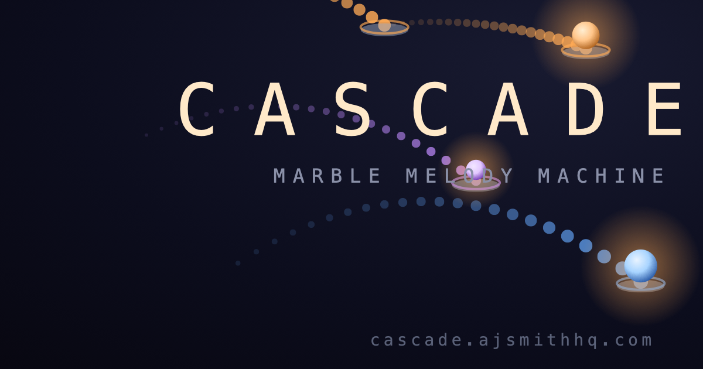

# Cascade — marble melody machine

**Live: [cascade.ajsmithhq.com](https://cascade.ajsmithhq.com)** · drop any `.mid` on the page — the solver does the rest.



## The idea

**The melody is authored first; the physics is solved backward from it.**
Pads are not simulated — each pad's launch velocity is the closed-form
ballistic solution that lands the marble on the next pad in exactly the
note's duration:

```
v0 = (ΔP − ½·g·dt²) / dt
```

Position during an arc is the analytic `P(t) = P0 + v0·t + ½·g·t²`. There is
no integrator, therefore no drift, therefore audio/visual sync is
structurally perfect forever. Rhythm is literally visible: long notes are
tall arcs, fast runs are flat skims.

Time is the only state — every marble position, pad swing, and anticipation
glow is a pure function of `T`. That's why the director camera can cut to
the action *before it happens*, why you can scrub the timeline (`?debug`),
and why a recording started and stopped at the loop seam produces a
seamlessly looping video.

## Features

- **9-song catalog** — Beethoven, Bach, Pachelbel, Grieg, Satie, and friends,
  each hand-transcribed as pure data
- **MIDI import** — drag any `.mid` onto the page; onsets are quantized and
  the physics re-solves
- **Share links** — the whole song travels in the URL (`#s=`,
  deflate-compressed), no backend
- **Record one perfect loop** — seam-to-seam capture that loops seamlessly,
  with the audio mix
- **Dual-path audio** — raw Web Audio synth, with a pre-rendered WAV
  `<audio>`-element fallback hardened against iOS WebKit (see
  `CLAUDE.md` §3 for the war)

## Development

```bash
npm install
npm run dev           # vite dev server
npm test              # vitest: lock-rule + MIDI + share suites
npm run build         # production build (dist/)
npm run build:single  # regenerate marble-cascade.html, the single-file artifact
```

## Song format

```js
{
  label, sub, bpm,
  scale: ['A','B','C', ...],        // pitch classes, drives pad-rim hues
  melody: [['E5', .5], ...],        // [note, beats-until-next-hit]
  alto:  { delay, notes },          // optional
  bass:  { delay, notes },          // optional
}
```

**The lock rule:** for every track, `sum(beats) + delay` must equal the
melody's total exactly, or it desyncs at the loop seam. The test suite
enforces it; the MIDI converter guarantees it by construction.

---

Born as a single-file [Claude](https://claude.ai) artifact, raised into a
repo. The full architecture notes live in `CLAUDE.md`.
